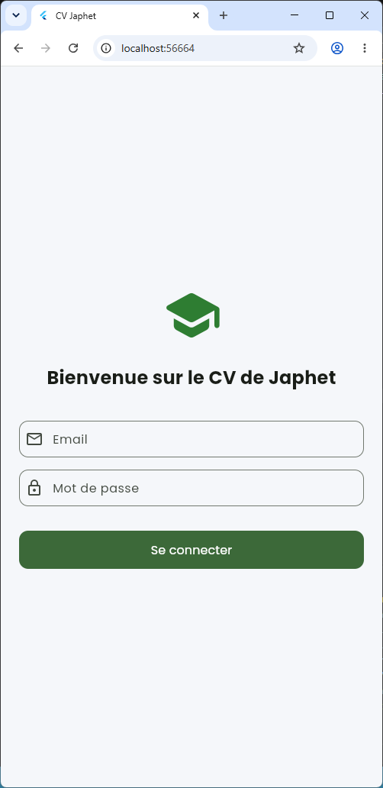
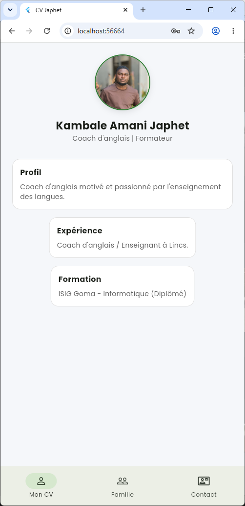
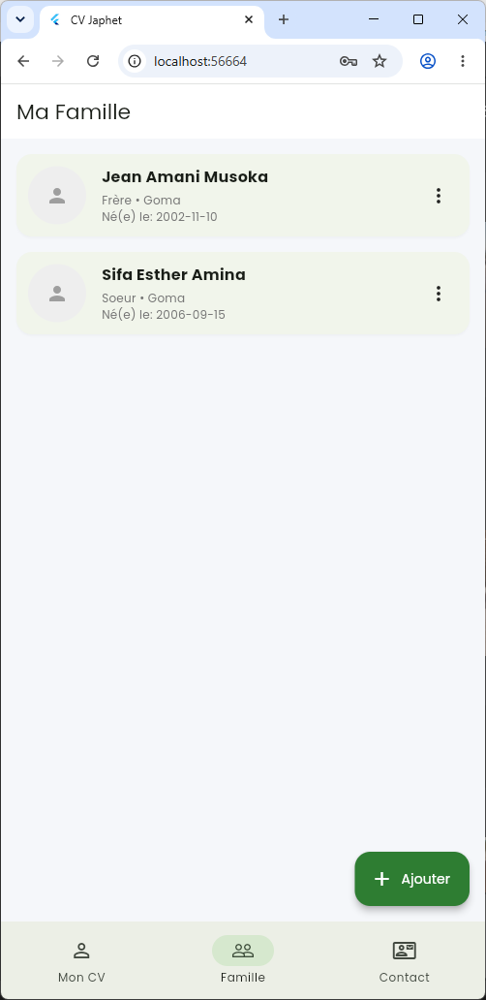
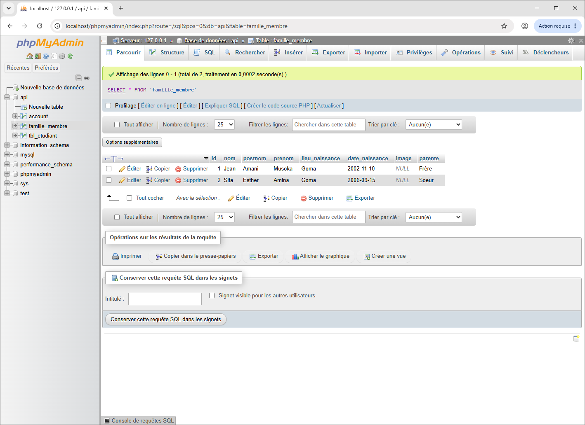

## 📸 Captures d'écran

### 1. Page de connexion

### 2. Page d'accueil (CV)

### 3. Page Famille
**Liste des membres :**

**Formulaire d'ajout / modification :**

### 4. Page Contact

### 5. Base de données MySQL (phpMyAdmin)

---

##  Démonstration Vidéo (Communication App & Base de données)

*Voici la vidéo montrant la communication entre l'application Flutter, l'API et la base de données MySQL.*

<video src="screenshots/video.mp4" controls="controls" style="max-width: 100%;">
Votre navigateur ne supporte pas la balise vidéo. Vous pouvez télécharger la vidéo [ici](screenshots/video.mp4).
</video>

*(Si la vidéo ne s'affiche pas directement ci-dessus, vous pouvez la visualiser en cliquant sur ce lien : [Voir la vidéo de démonstration](screenshots/video.mp4))*